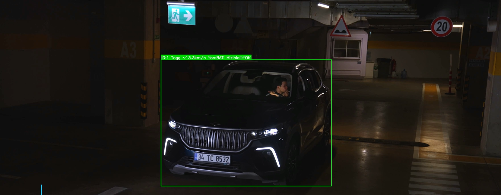

# 🚦 FifthWave – Smart Road Safety with 5G & AI

Computer vision pipeline built by **Team FifthWave** for the **TEKNOFEST 2026 “Smart Road Safety with 5G & AI”** competition. Our preliminary design report scored **91.33**.

The system watches traffic video and flags risky situations: what the driver is doing inside the car, which vehicle it is, and how vehicles move on the road.



---

## 🧩 What's inside

### `detection/` – driver & vehicle detection (YOLO)

A Kaggle notebook that chains several custom-trained YOLO models on the same video:

- **Driver behavior** — finds the windshield, isolates the driver and detects **phone use, smoking and seat belt** status
- **Vehicle identification** — detects TOGG vehicles and emergency vehicles
- **License plates** — locates the plate, then reads its characters with a second model
- **Driver fatigue** — a separate fatigue detection model

### `tracking/` – vehicle tracking & speed estimation

A modular Python pipeline for traffic analysis:

| Module | Role |
|---|---|
| `vehicle_detector.py` | YOLO vehicle detection |
| `tracker.py` | multi-object tracking with **DeepSORT** |
| `lane_detector.py` · `lane_memory.py` · `lane_manager.py` | lane line detection, smoothing over frames and lane assignment |
| `trajectory_manager.py` | per-vehicle trajectory history |
| `speed_estimator.py` | speed in km/h from lane width (3.5 m) and flags speed violations |
| `direction_estimator.py` | heading angle and lane / direction changes |
| `visualizer.py` | draws boxes, labels and lanes on the output video |
| `config.py` | every threshold in one place |

## 🧠 My part

I developed the **driver behavior module** (phone use, smoking, seat belt) with **YOLOv11**, and handled data collection, cleaning and augmentation for it.

## ⚙️ Run the tracking pipeline

```bash
cd tracking
pip install -r ../requirements.txt
python main.py
```

Model weights (`*.pt`) and test videos are **not included** in this repository because of their size. Set your own paths in `main.py` / `config.py`.

## 🧱 Tech stack

Python · YOLOv11 / Ultralytics · OpenCV · DeepSORT · NumPy · Kaggle · Roboflow

---

Team FifthWave · TEKNOFEST 2026 · [Layan Bassout](https://leya1133.github.io)
